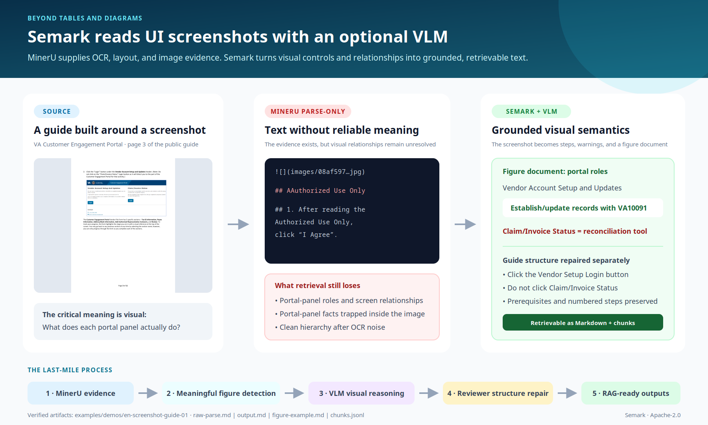

# Semark

[English](README.md) | **繁體中文**

> 把 PDF、Word、投影片與圖片轉成 RAG 可用的 Markdown，逐頁對照原文核對，並標明哪些內容已核對、哪些沒有。

Semark 是可自行架設的文件處理服務。它用 MinerU 與 Word 原生解析取出文字、表格與圖片，再交給你指定的視覺模型（本機 Ollama，或任何 OpenAI 相容 API），讀懂表單、流程圖、圖表與操作截圖。最後把每一頁和原文對照，產出可以直接匯入知識庫的 Markdown 與 chunks。



## 和一般 PDF 轉 Markdown 工具的差別

- **原文不漏字。** 交付前，逐段檢查原文的文字是否都出現在交付的文件與 chunks 裡，結果寫進品質報告；缺的內容會在審查階段補回或明確標出，不會悄悄消失。
- **看得懂圖。** 表單、流程圖、圖表、軟體操作截圖會轉成可檢索的文字：欄位、分支條件、紅框標示、選單路徑都留下來。解析器把表格欄位併在一起時，會從表格圖片重建格線。
- **逐頁核對，誠實標示。** 模型逐頁比對原圖與交付內容，發現錯誤就修正並重新核對。看不清的地方標「無法可靠辨識」，不猜；沒能核對的圖片只保留從圖上讀到的字，並在閱讀版標「未核對」。
- **資料留在你手上。** 可以完全在本機或內網執行，沒有設定雲端端點就不會把文件送出去。

## 看看效果

每個 demo 都把公開的來源頁面和 Semark 的輸出並排比較，完整說明在 [docs/DEMOS.zh-TW.md](docs/DEMOS.zh-TW.md)，檔案在 `examples/demos/`。

| 痛點 | Semark 的做法 | Demo |
| --- | --- | --- |
| 操作手冊裡的截圖對檢索是隱形的：選單名稱、紅框、欄位提示都只是像素 | 截圖轉成語意描述、選單／按鈕路徑，以及和畫面文字比對過的內容 | [繁中截圖教學](docs/DEMOS.zh-TW.md#繁體中文截圖教學國庫繳款書列印) |
| 流程圖一變成文字，判斷邏輯就不見了 | 條件、分支、負責單位寫成結構化 Markdown | [繁中流程圖](docs/DEMOS.zh-TW.md#繁體中文流程圖性騷擾申訴對象標準作業流程) |
| 截圖為主的頁面被誤判，OCR 雜訊直接進知識庫 | 重建成乾淨的分步指南，裝飾性圖示自動過濾 | [英文截圖教學](docs/DEMOS.zh-TW.md#英文截圖教學va-入口網登入) |
| 表單 OCR 出來是一堆沒有結構的欄位 | 用途、填寫規則、欄位分組、法律聲明整理成固定格式 | [英文表單](docs/DEMOS.zh-TW.md#英文表單uscis-g-1145) |

## 快速開始

需要 Docker。要用本機模型的話，先在主機上安裝 Ollama 並拉好模型：

```bash
git clone https://github.com/KingsleyOWO/Semark.git
cd Semark

export SEMARK_VLM_BASE_URL=http://host.docker.internal:11434/v1
export SEMARK_VLM_API_KEY=ollama
export SEMARK_VLM_MODEL=your-vision-model

docker compose up --build
```

打開 `http://localhost:5070`，上傳文件，勾選後用 `accurate` 執行。完成後在 `Viewer` 對照原頁與輸出，在 `文件管理` 下載 Markdown、DOCX 或 TXT。

- Linux／WSL 的容器若連不到主機上的 Ollama，改用 `docker compose -f docker-compose.full.host.yml up --build`。
- 改用雲端模型：把 `SEMARK_VLM_BASE_URL` 與 API key 換成服務商提供的值。核對用的模型可以另外指定更強的（`SEMARK_REVIEW_VLM_*`），沒指定就沿用同一個。
- 本機安裝、常駐 MinerU、連接埠與主機名稱、內建範例等，見 [docs/INSTALL.zh-TW.md](docs/INSTALL.zh-TW.md)。

> **你的資料存在 Docker volume 裡。** `docker compose down -v` 會永久刪除所有上傳文件與處理結果；升級時用不帶 `-v` 的 `docker compose down`。

## 運作方式

1. **解析**：PDF 與圖片交給 MinerU 取出文字、版面與表格；Word 直接讀原生結構（失敗時才轉 PDF）。
2. **視覺補強**：視覺模型讀表單、流程圖、圖表與截圖；欄位併在一起的表格從圖片重建格線。
3. **打包分檔**：產出主文與可獨立檢索的子文件（表單、表格、流程圖、圖片），附 chunks 與來源對照。
4. **逐頁核對**：每一頁都列入清單，模型比對原頁與實際交付內容；有問題時選擇工具修正（重讀圖片、局部改字、補回漏掉的內容），修正後重新產出並再核對一次。
5. **最終驗證**：檢查原文覆蓋、核對紀錄與交付內容一致，才發布這一版結果。

細節與設定見 [backend/docs/agentic-processing.md](backend/docs/agentic-processing.md)。

## 輸出內容

- `documents/`：匯入 RAG 用的整包文件，包括主文 `main.md` 與各張圖、表、表單的子文件。這裡的文字保持乾淨，核對狀態另外記在 metadata。
- `chunks.jsonl`：切好的 chunks，每段都帶來源區塊編號。
- `delivery.md`：給人閱讀的版本，每張圖前面標出核對狀態。
- 品質與覆蓋報告：哪些頁已核對、哪些待確認，原文文字是否完整交付。

閱讀版裡會看到的標示：

| 標示 | 意思 |
| --- | --- |
| 〔圖片內容：自動辨識，已核對〕 | 模型讀出的圖片內容，已和原圖比對過 |
| 〔圖片內容：自動辨識，未核對〕 | 沒能完成比對，只保留從圖上讀到的字 |
| 〔原文第 N 頁圖片：無法可靠辨識的文字或必要內容〕 | 圖上這部分看不清，留空而不是猜 |
| 〔內容可能不完整：原文第 N 頁仍有未核對範圍〕 | 這一頁還有沒核對到的部分 |

英文輸出使用對應的英文標示，例如 `[Image content: automatic reading, verified]`。

## 處理時間與限制

- **逐頁核對很花時間。** 每份文件預設的處理時間上限是 6 小時（含初稿），時間到就停止核對。舉例：一份 97 頁、圖片很多的 Word 報告，在一台 DGX Spark 上用 27B 的本機視覺模型，初稿約 2 小時、核對約 4.3 小時。要更快，可以縮短時間上限，或在建立工作時把 `agentic.mode` 設成 `off`（見[說明](backend/docs/agentic-processing.md)）。
- **不保證每頁都核對通過。** 同一份報告 97 頁中有 57 頁完整核對通過，其餘頁面記為待確認或未核對，不會算成通過；時間用完時沒輪到的頁面也一樣。
- **結果受模型影響。** 圖片的描述句（例如把甜甜圈說成泡芙）和流程圖的分支關係，讀錯時不一定擋得下來；圖上的字和數字有比較嚴格的檢查。
- **OCR 證據是選配的。** 環境裡有 PaddleOCR 時（`SEMARK_OCR_PYTHON_PATH` 指向裝了 `paddleocr` 的 Python），修正圖片時會拿它當第二份證據；預設的 Docker 映像不含 PaddleOCR。
- **截圖可能帶出個人資訊。** 「遮蔽個人資訊」預設開啟，但它是樣式比對的最後防線；最可靠的做法是上傳前先把個人內容蓋掉。詳見 [docs/DEMOS.zh-TW.md](docs/DEMOS.zh-TW.md#截圖文件與個人資訊)。

## 支援格式

PDF、DOC／DOCX、PPT／PPTX、XLS／XLSX、ODT／ODP／ODS、HTML、PNG／JPG。輸出語言可設為 `auto`、`zh-TW` 或 `en`，專有名詞可保留英文。

## 安全性

這個服務設計給本機或可信任的內網使用，API 沒有登入驗證，請勿直接開放到網際網路。其他設定見 [docs/INSTALL.zh-TW.md](docs/INSTALL.zh-TW.md)。

## 授權

本專案原始碼以 Apache License 2.0 發布，見 `LICENSE`。第三方元件維持各自授權：PyMuPDF／MuPDF 為 AGPL-3.0 或商業授權，MinerU、模型權重與雲端服務請依各自條款，詳見 [THIRD_PARTY_LICENSES.md](THIRD_PARTY_LICENSES.md)。

## 更多文件

- [安裝、設定與部署](docs/INSTALL.zh-TW.md)
- [Demo 對照](docs/DEMOS.zh-TW.md)
- [逐頁核對與修復流程](backend/docs/agentic-processing.md)
- [Release Notes 2026-10-27（v0.4.0）](RELEASE_NOTES_20261027.zh-TW.md)
