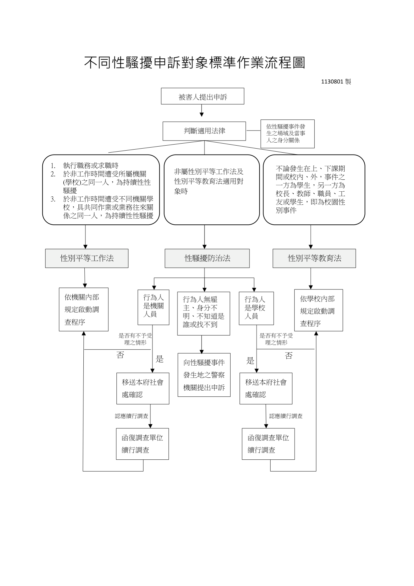
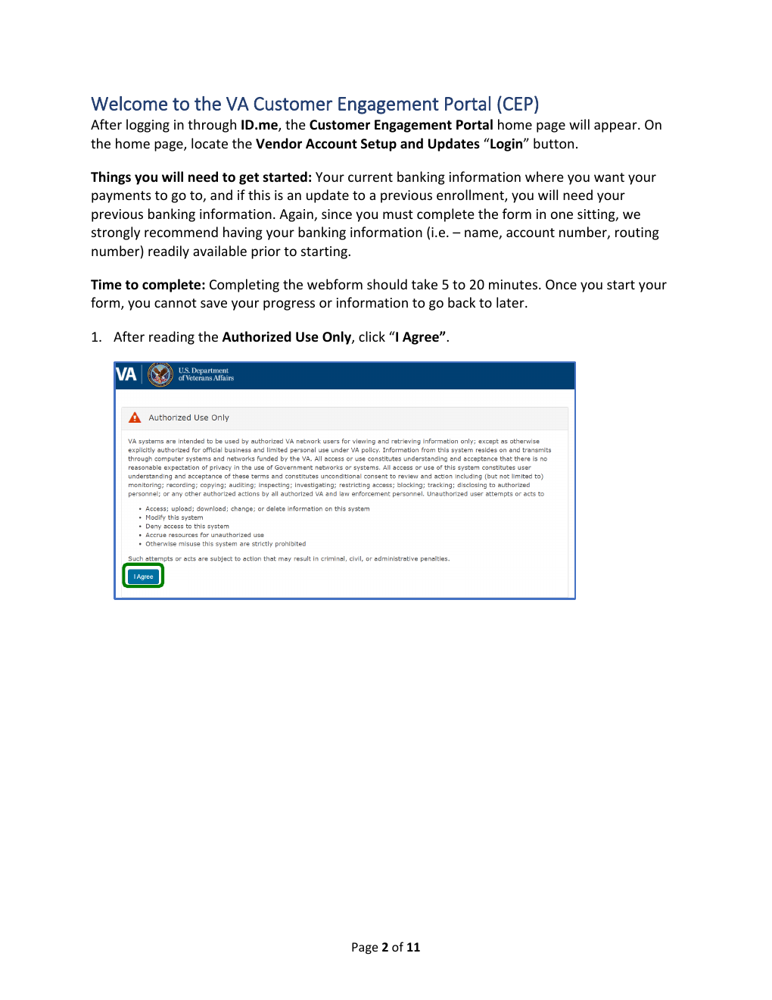
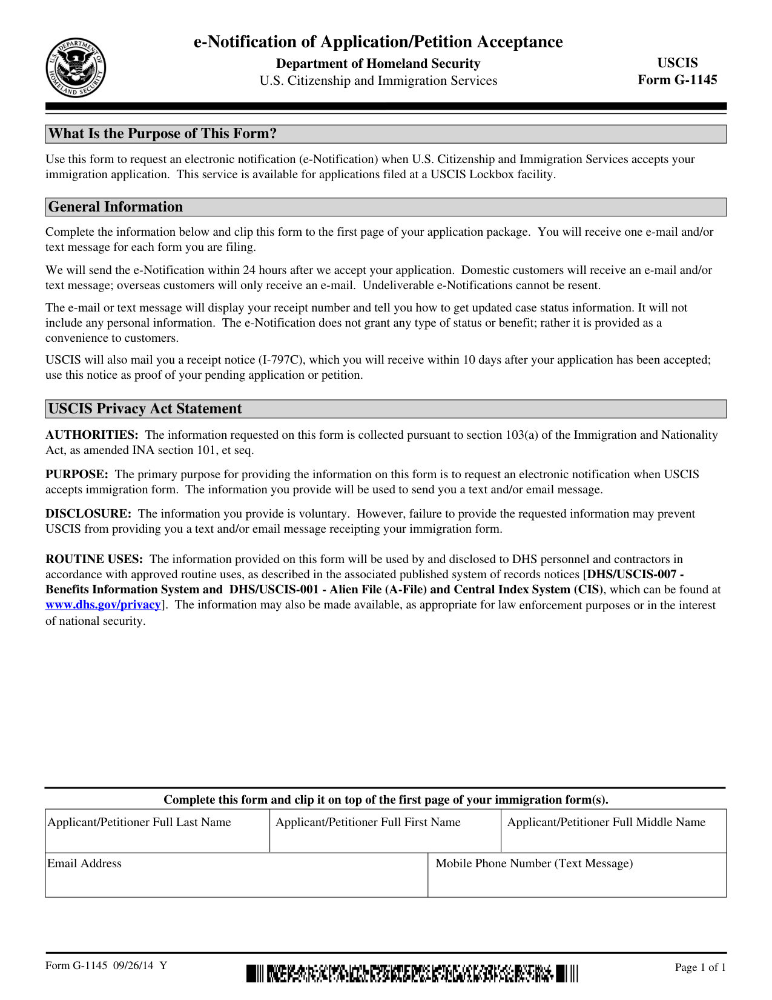

# Semark Demo

[English](DEMOS.md) | **繁體中文** · [回到 README](../README.zh-TW.md)

國庫繳款書截圖教學以 v0.4.0 重新產生，含逐頁核對與「已核對」標示。其他三個 demo 仍是 v0.3（2026-07）的輸出，當時還沒有逐頁核對；用 v0.4.0 重跑時，流程圖有兩條分支的上層讀錯（卻通過核對），兩份英文文件的排版也不如舊版，所以保留舊版。

## Demo 對照

每個 demo 都把「真實的公開來源頁面」與「產出的 RAG-ready semantic Markdown」放在一起，而且各自對準一個具體痛點。完整檔案（主文、圖片語意文件、chunks、品質報告）位於 `examples/demos/`。

| 痛點 | Semark 的做法 | Demo |
| --- | --- | --- |
| 教學手冊裡的 UI 截圖對檢索是隱形的——選單名稱、紅框標示、欄位提示都只是像素 | 截圖轉成語意描述、選單／按鈕路徑、與畫面文字比對過的可檢索內容 | [繁中截圖教學](#繁體中文截圖教學國庫繳款書列印) |
| 流程圖一變成文字就失去決策邏輯 | 條件、分支、負責單位寫成結構化 Markdown | [繁中流程圖](#繁體中文流程圖性騷擾申訴對象標準作業流程) |
| 截圖為主的版面容易被解析器誤判，OCR 雜訊直接流進知識庫 | Reviewer 模型重建成乾淨的分步指南，裝飾性圖示自動過濾 | [英文截圖教學](#英文截圖教學va-入口網登入) |
| 表單 OCR 出來是一鍋欄位湯，沒有可用結構 | 用途、填寫規則、欄位分組、法律聲明整理成固定 RAG 模板 | [英文表單](#英文表單uscis-g-1145) |

> **關於個人資訊**：以上截圖 demo 的來源都是公開文件，不含個人資訊。實際使用時，「遮蔽個人資訊」預設開啟，會把截圖轉錄常見的個人內容（信件主旨與寄件人、網域帳號工號、email 帳號數字）在輸出前確定性遮蔽；但遮蔽是樣式比對的最後防線——如果你完全不希望個人資訊出現在文檔裡，最可靠的做法是**準備截圖時就不要納入個人資訊**（先蓋掉或模糊化再截圖）。詳見[截圖文件與個人資訊](#截圖文件與個人資訊)。

### 繁體中文截圖教學：國庫繳款書列印

**痛點：** 截圖型手冊裡真正重要的資訊——點哪個選單、哪個選項被紅框標示、每個欄位要填什麼——都在圖片裡，純 OCR 管線檢索不到。

這個 demo 以 v0.4.0 重新產生（含逐頁核對），兩頁都核對通過。

**來源頁面**（第 2 頁，資料登打畫面）


**只做解析／OCR 的管線會得到什麼**——這是解析層對兩頁的「完整」原始輸出（[raw-parse.md](../examples/demos/zh-screenshot-guide-01/raw-parse.md)）：

```markdown
## 列印國庫繳款書操作說明

繳款書(01)條碼化作業

歡迎使用 VEB 系統請點選上方功能清單進入作業功能

版權所有 中華民國 109 年，財政部國庫署，建議解析度 1024×768 以上。客服電話:02-2395-7500#325,#329 20160302-1517

【說明】

請使用 Google chrome 瀏覽器，連結至「國庫收支書表條碼化 web 版」首頁」(http://veb.nta.gov.tw/).  
點選畫面左上角「繳款書(01)條碼化作業」進入資料登打畫面。


## 【說明】

1.請依紅框說明文字輸入相關資訊後，點選右上角「列印」即可產製國庫繳款書（為利條碼讀取，請以雷射印表機列印）。

2. 備註欄案號，請填法院裁定遺管人之案號(如：台北地院108年度司繼字第0號）。
```

整個資料登打畫面——每個欄位、每個提示值、所有紅框——就是那一行死圖連結。對這份輸出做 RAG，關於表單的任何問題都答不出來。

**Semark 的輸出**（閱讀版節錄，[delivery.md](../examples/demos/zh-screenshot-guide-01/delivery.md)；匯入 RAG 的[主文](../examples/demos/zh-screenshot-guide-01/output.md)內容相同但不含核對標記）

```markdown
## 列印國庫繳款書操作說明

繳款書(01)條碼化作業

歡迎使用 VEB 系統請點選上方功能清單進入作業功能

版權所有 中華民國 109 年，財政部國庫署，建議解析度 1024×768 以上。客服電話:02-2395-7500#325,#329 20160302-1517

【說明】

請使用 Google chrome 瀏覽器，連結至「國庫收支書表條碼化 web 版」首頁」(http://veb.nta.gov.tw/).  
點選畫面左上角「繳款書(01)條碼化作業」進入資料登打畫面。

〔圖片內容：自動辨識，已核對〕
此為國庫署「VEB001R 繳款書(01)條碼化作業」網頁表單截圖，畫面以紅框標示各必填欄位並附輸入說明文字（如會計年度、收入科目代號、繳款人、備註等），右上角「列印」按鈕亦以紅框強調，用於產製國庫繳款書條碼。
畫面為國庫署「VEB001R 繳款書(01)條碼化作業」表單介面，頂部另有支出收回書(02)、收入退還書(03)、轉正通知書(05/04)等條碼化作業分頁。
右上角功能按鈕包含「匯入」「匯出」「列印」「清除」，其中「列印」以紅框標示。
紅框欄位說明：會計年度需輸入繳款年度；收入科目代號請輸入「12171002103」；收入科目名稱請輸入「其他雜項收入」。
紅框欄位說明：收入機關代號與對帳機關代號皆請輸入「1710003」，收入機關名稱與對帳機關名稱皆請輸入「國庫署」。
紅框欄位說明：填發機關請輸入「國庫署」；繳款人請輸入「遺管人○○○繳納被繼承人○○○賸餘現金」；備註請輸入聯絡電話及案號。
填發日期與款項所屬年月欄位提示「請依下拉式表單選取」，並顯示空白日期格式（__/__/__ 與 __/__）。
金額欄位預設值為「0」，並提示「請輸入繳款金額」。
```

截圖裡的紅框標示與欄位提示全部變成可檢索的純文字，而且已和原圖核對過——對 RAG 系統問「收入科目代號要填什麼」，它可以拿這一頁當來源回答「12171002103」。

### 繁體中文流程圖：性騷擾申訴對象標準作業流程

**痛點：** 流程圖的決策邏輯（適用哪部法、誰調查、期限多久）在圖片被丟棄或攤平成 OCR 的那一刻就消失了。

**來源頁面**



**完整語意化 Markdown**

```markdown
# 不同性騷擾申訴對象標準作業流程圖

版本日期：1130801製（民國113年8月1日）

適用目的：規範被害人提出性騷擾申訴後，依事件場域及當事人身分關係判斷適用法律，並啟動相應調查或處理程序之標準作業流程。

## 一、適用法律判斷基準

依性騷擾事件發生之場域及當事人之身分關係，判斷適用以下法律：

### 《性別平等工作法》適用情形

- 執行職務或求職時遭受性騷擾。
- 於非工作時間遭受所屬機關（學校）之同一人，為持續性性騷擾。
- 於非工作時間遭受不同機關學校，具共同作業或業務往來關係之同一人，為持續性性騷擾。

### 《性別平等教育法》適用情形

- 不論發生在上、下課期間或校內、外，事件之一方為學生，另一方為校長、教師、職員、工友或學生，即屬校園性別事件。

### 《性騷擾防治法》適用情形

- 非屬《性別平等工作法》及《性別平等教育法》適用對象時。

## 二、申訴處理流程與調查程序

起點：被害人提出申訴 → 判斷適用法律 → 依行為人身分啟動對應程序。

### （一）適用《性別平等工作法》或《性別平等教育法》

- 行為人是機關人員：依機關內部規定啟動調查程序。
- 行為人是學校人員：依學校內部規定啟動調查程序。

### （二）適用《性騷擾防治法》（依行為人身分分流）

行為人是機關人員／學校人員：

- 判斷是否有不予受理之情形？
- 是：移送本府社會處確認 → 認應續行調查 → 函復調查單位續行調查。
- 否：回歸依機關／學校內部規定啟動調查程序。

行為人無雇主、身分不明、不知道是誰或找不到：

- 向性騷擾事件發生地之警察機關提出申訴。

## 三、填寫與處理說明

- 本流程圖為標準作業指引，各機關（學校）應依內部規定配合執行調查程序。
- 涉及移送社會處確認或警察機關申訴之案件，應保留完整紀錄並函復相關調查單位。
```

### 英文截圖教學：VA 入口網登入

**痛點：** 文字與 UI 截圖混排的頁面常被誤判成可填寫表單，產出不是模板噪音就是原始 OCR。這份 demo 中 reviewer 修復把頁面重建回它真正的樣子——一份分步指南。

**來源頁面**（第 1 頁，Authorized Use 對話框）



**只做解析／OCR 的管線會得到什麼**（原始輸出節錄，[raw-parse.md](../examples/demos/en-screenshot-guide-01/raw-parse.md)）：

```markdown


## 1. After reading the Authorized Use Only, click “I Agree”.

## AAuthorized Use Only

• Deny access to this system


```

截圖全是死圖連結（入口網面板上的 VA10091、SAM.gov、聯絡資訊在文字層完全不存在），OCR 錯字「AAuthorized」被升級成章節標題，操作步驟也變成了標題。

**Semark 產出的 semantic Markdown**（主文節錄，[完整主文](../examples/demos/en-screenshot-guide-01/output.md)）

```markdown
# Welcome to the VA Customer Engagement Portal (CEP)

After logging in through **ID.me**, the **Customer Engagement Portal** home page will appear. On the home page, locate the **Vendor Account Setup and Updates** "Login" button.

## Things you will need to get started
*   Your current banking information where you want your payments to go to.
*   If this is an update to a previous enrollment, you will need your previous banking information.

## Time to complete
Completing the webform should take **5 to 20 minutes**. Once you start your form, you cannot save your progress or information to go back to later.

## Instructions

### 1. Accept Terms of Use
After reading the **Authorized Use Only** notice, click "**I Agree**".

### 2. Navigate to Vendor Setup
Click the "**Login**" button under the **Vendor Account Setup and Updates** header.

> **Note:** Do not click on the "**Claim/Invoice Status**" Login button as it will direct you to the part of the Customer Engagement Portal for that activity.

## Vendor File Form (VA10091) Details
The Customer Engagement Portal Vendor File Form has 5 specific sections:
1.  Tax ID Information
2.  Payee Information
3.  Address/Bank Information
4.  Add Authorized Representative Contact/s
5.  Review
```

裝飾性的警告小圖示被自動過濾，有意義的截圖各自成為帶接地語意的圖片文件，「不要按錯 Login 按鈕」的警告變成檢索得到的明確指示。

### 英文表單：USCIS G-1145

**痛點：** 政府表單 OCR 出來是一鍋沒有結構的欄位湯；要回答「這張表單做什麼、怎麼填」，需要用途、規則與欄位分組。

**來源頁面**



**完整語意化 Markdown**

```markdown
# USCIS Form G-1145: e-Notification of Application/Petition Acceptance

## Identity & Purpose
- **Form ID:** G-1145 (09/26/14Y)
- **Agency:** U.S. Citizenship and Immigration Services (USCIS), Department of Homeland Security
- **Purpose:** Request an electronic notification (e-Notification) via email and/or text message when USCIS accepts your immigration application or petition filed at a Lockbox facility. This service is provided as a convenience and does not grant any status or benefit.

## Instructions for Completion & Submission
- Complete this form and clip it to the first page of your application package.
- You will receive one e-Notification per form filed.
- **Delivery Timeline:** Notifications are sent within 24 hours after USCIS accepts the application.
- **Recipient Rules:**
  - Domestic customers: Email and/or text message.
  - Overseas customers: Email only.
- **Important Notes:** Undeliverable e-Notifications cannot be resent. The notification will display your receipt number and a link to check case status, but will not contain personal information. USCIS will also mail a physical receipt notice (I-797C) within 10 days of acceptance.

## Required Fields
Grouped by meaning for completion:
- **Applicant/Petitioner Identification:**
  - `Applicant/Petitioner Full Last Name`
  - `Applicant/Petitioner Full First Name`
  - `Applicant/Petitioner Full Middle Name`
- **Contact Information:**
  - `Email Address` (Required for all)
  - `Mobile Phone Number (Text Message)` (Required for domestic text notifications)

## Privacy Act Statement & Legal Disclosures
- **Authorities:** Collected pursuant to section 103(a) of the Immigration and Nationality Act (INA).
- **Purpose:** To request electronic notification upon USCIS acceptance of immigration forms.
- **Disclosure:** Provision is voluntary. Failure to provide information may prevent receipt of text/email notifications.
- **Routine Uses:** Information will be used/disclosed to DHS personnel and contractors per approved system of records notices [DHS/USCIS-007 & DHS/USCIS-001]. May also be shared for law enforcement or national security purposes.

## RAG Query Anchors
- Form G-1145 e-Notification purpose, Lockbox filing instructions, 24-hour notification timeline, domestic vs overseas delivery rules, I-797C receipt notice mailing timeframe, Privacy Act authorities and routine uses, field completion requirements.
```

## Demo 模型說明

目前 curated demo snapshots 是在測試環境中使用本地 Ollama 模型 `qwen3.6:35b-a3b-q8_0` 產生，該模型同時作為 enrichment 與 reviewer model。若改用更強的 vision model 或 reviewer model，理論上在語意修復、視覺理解、欄位分組與流程判讀上會有更好的效果。因此 demo 展示的是目前 pipeline 的輸出形態，不代表模型能力上限。

## 截圖文件與個人資訊

Semark 把「截圖為主的文件」（軟體操作手冊、內部教學、新人上手指南）當成一級輸入來處理：

- **截圖理解**：UI 截圖會被轉成語意描述——畫面在顯示什麼、哪個選單或按鈕被標示、畫面上看得到的文字——即使來源是圖片，操作步驟仍然可以被檢索。描述會與文件中實際出現的文字做比對（grounding），抑制幻覺出來的產品或廠商名稱；裝飾性圖示與無法辨識的裁切圖會自動從 RAG 輸出與 chunks 中過濾。
- **只下載主文**：如果交付成果不需要圖片附件，下載選單可以只匯出主文，內容與文件檢視畫面顯示的完全一致。
- **個人資訊遮蔽**：真實截圖常常帶出與教學無關的內容（信箱的信件主旨與寄件人、網域帳號工號如 `CORP\x12345`、個人 email 帳號數字）。「遮蔽個人資訊」**預設開啟**（可在設定的「輸出封裝」中關閉），開啟時這些樣式會在所有交付輸出（Markdown、分檔文件、chunks）中被確定性遮蔽，而帳號格式說明這類教學本體會保留。

要提醒的是：遮蔽是針對常見樣式的最後防線，不是保證。如果個人化的圖片或資訊完全不應該出現在文檔上，請在處理前就先把來源截圖中的個人內容蓋掉或模糊化——沒有上傳的內容才是真正不會外流的內容。
