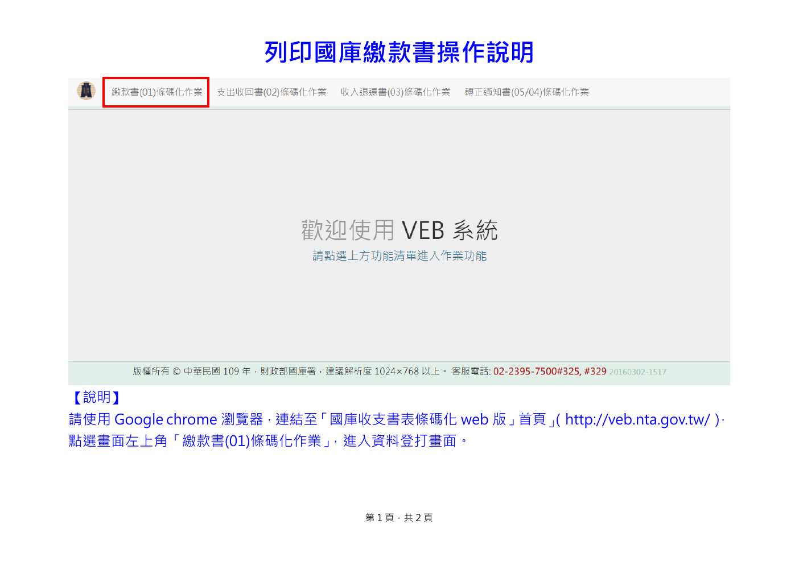
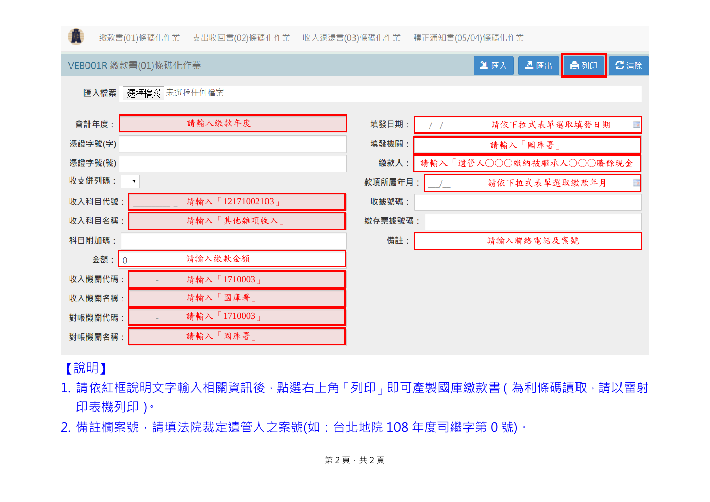

# 繁體中文截圖教學 Demo：國庫繳款書列印

這個 demo 是一份共兩頁、主要由 UI 截圖構成的繁體中文操作說明，以 v0.4.0 的 `accurate` profile 處理，含逐頁對照原文核對。截圖中的選單列、紅框標示、資料輸入欄位與欄位提示，會被轉成語意描述及可檢索文字，而不是留在 RAG 無法讀取的圖片中；兩頁都核對通過，閱讀版在截圖內容前標「已核對」。

## 來源頁面

## 產出檔案

- [raw-parse.md](raw-parse.md)：只做解析／OCR 的完整原始輸出；資料登打畫面在結果中只剩一條圖片連結。
- [output.md](output.md)：整合正文與圖片解釋的主文，也是 Viewer 顯示及下載「主文」時取得的內容。
- [delivery.md](delivery.md)：給人閱讀的版本，每張圖前標出核對狀態（這份兩頁都是「〔圖片內容：自動辨識，已核對〕」）。
- [figure-example.md](figure-example.md)：獨立的圖片語意文件；將表單畫面整理成語意事實與畫面文字。
- [chunks.jsonl](chunks.jsonl)：由語意輸出建立的檢索 chunks。
- [quality_gate.json](quality_gate.json)：品質檢查結果，見下方說明。

## 建議比較重點

- 比較 [raw-parse.md](raw-parse.md) 與 [output.md](output.md)：原始解析中，整個資料輸入畫面只剩一條圖片連結；語意輸出則讓每個欄位提示都成為可檢索文字。
- 第 2 頁的紅框提示（右上角「列印」按鈕、各必填欄位）會保留成檢索得到的文字。
- 表單截圖中的欄位提示，例如收入科目代號「12171002103」及機關代碼「1710003」，會轉錄成畫面文字，並整理成語意事實。
- [delivery.md](delivery.md) 顯示核對結果；匯入 RAG 的 `output.md` 與 chunks 不含這些標記，核對狀態記在 metadata。

## 品質檢查說明

`quality_gate.json` 的狀態是 `needs_review`（0.63），有兩項提醒：這份一般文件沒有產生結構化紀錄（`structured_output_empty`），以及兩段原文在結構化輸出中找不到（`authored_text_dropped`）。這兩段文字（版權與客服資訊、操作說明第一段）都在 `output.md` 與 chunks 裡；原文覆蓋檢查與最終驗證都通過，兩頁也都核對通過。提醒來自品質檢查拿結構化輸出比對，不是內容遺失。

## 模型說明

這份 snapshot 在一台 DGX Spark 上使用本機 Ollama 模型 `qwen3.8:27b`，同時作為讀圖與核對模型。

## 執行資訊

- 版本：v0.4.0（處理流程 `delivery-v20.31`）
- Run ID：`01M5HGPSHBHJARB0GCRRMQKN2C`
- Document ID：`01548cad5a53992d`
- Profile：`accurate`（含逐頁核對）
- 輸出語言：`zh-TW`
- 頁面核對：2／2 頁已核對

## 來源標示

來源頁面取自中華民國財政部國庫署公開的「國庫收支應用書表條碼化 Web 版」國庫繳款書列印操作說明：

- 系統：<https://veb.nta.gov.tw/>
- 機關資訊頁：<https://www.nta.gov.tw/singlehtml/241?cntId=8ab3b311519146c7bd4126f8a72fc260>

原始 PDF 已不在機關網站上，這次以 repo 中保存的兩張來源頁面圖片合成 PDF 作為輸入，所以全部文字都經過 OCR，沒有原生文字層。

## 注意事項

這份教學說明的是公開政府系統的操作流程。畫面中的電話號碼與欄位範例值均為機關公開的非個人資訊。本輸出用於展示截圖型文件轉成 RAG-ready 語意內容後的形式，不取代官方操作說明。
